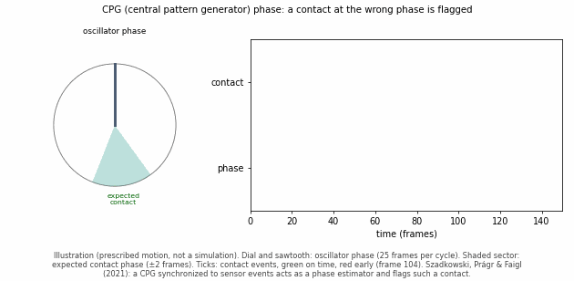

# Central pattern generator (CPG), from scratch

**Intuition:** a CPG is an internal metronome for movement. It ticks rhythmically by itself, and each tick tells the legs (or fins, or body segments) what to do: lift, swing, plant, push. Nothing outside has to say "now step" every time.

A **gait** is the repeating pattern of which legs are on the ground when, e.g. a tripod gait or a trot. Each leg alternates **stance** (on the ground, pushing the body) and **swing** (in the air, moving forward).

## 1. In animals

- Walking, swimming and breathing are rhythmic, but your brain doesn't plan each step one by one.
- Networks of neurons in the spinal cord produce the rhythm on their own. Classic experiments on cats (Brown 1911) and lampreys (an eel-like fish) showed that this rhythm continues even with the brain's input largely cut off (reviewed in Ijspeert 2008).
- The brain sets the speed and direction. The CPG produces the beat.

## 2. The three parts

| Part | What it does | Everyday analogy |
| --- | --- | --- |
| **Oscillator** | Produces a repeating cycle | A metronome ticking |
| **Coupling** | Keeps the legs' oscillators at fixed timing offsets from each other; that pattern of offsets is the gait | Rowers keeping stroke together |
| **Sensory feedback** | Nudges the rhythm when reality disagrees, e.g. a foot hits the ground early | The metronome speeding up or slowing down to follow the dancer |

### Like a pendulum? Closer to a pendulum clock

| | Plain pendulum | Pendulum clock | CPG |
| --- | --- | --- | --- |
| Keeps going by itself? | No: friction slowly stops it | Yes: the escapement adds a small push each swing | Yes: neurons (or the robot's code) keep driving it |
| After a bump? | Keeps whatever new swing size the bump gave it | Settles back to its normal swing | Settles back to its normal rhythm |
| Can it be nudged into sync? | Not on its own | Two clocks on one wall can drift into step | Yes, by design: sensors and coupling shift its phase |

A rhythm that keeps itself going and returns to the same pattern after a disturbance is called a **limit cycle**.

Don't mix up the two pendulums in walking. Legs also swing like real physical pendulums: that is body mechanics, gravity swinging the leg forward. The CPG is the timer in the nervous system (or the robot's code) that decides *when* to swing. Real walking uses both, and the CPG's rhythm is often tuned to the leg's natural swing.

## 3. The key quantity: phase

- **Phase** $`\varphi`$ says where you are in one cycle. It runs from 0 to 1, then wraps back to 0, like the hand of a clock.
- In the simplest model it grows at a constant rate: $`\dot\varphi = \omega`$.
  - $`\dot\varphi`$ is how fast the phase changes.
  - $`\omega`$ is the step frequency, in cycles per second.

**Worked example:** a hexapod in a tripod gait, with $`\omega`$ = 1 cycle/s.

- The six legs form two groups of three, A and B, half a cycle apart (offset 0.5).
- From $`\varphi`$ = 0 to 0.5, group A is in stance and group B swings forward.
- From $`\varphi`$ = 0.5 to 1, they swap.
- So from $`\varphi`$ alone, at any moment, you know which legs should be on the ground.

**Coupling** pulls each leg's phase toward its intended offset from the others. If one leg lags, it speeds up a bit until the offset is restored.

## 4. Feedback is what makes it an estimator

- Suppose the CPG says a foot should touch down at $`\varphi`$ = 0.50, but the contact sensor fires at $`\varphi`$ = 0.45 (the ground was higher). That gap is a **phase error**.
- With feedback, the CPG shifts its phase toward what the sensors report. Once it stays synchronized, its phase is effectively an estimate of where the robot really is in its gait.
- That is the idea in the CTU lab's paper (Szadkowski, Prágr & Faigl 2021; see [`literature-review-other-locomotion.md`](literature-review-other-locomotion.md) §2.6): "If the CPG is synchronized to the sensory signals, the CPG acts as an estimator of the sensory phase."
- When the phase error added up over one cycle crosses a threshold, they flag a **mistiming**. Detections trigger an **elevator reflex** (lift the leg over an obstacle) and a **search reflex** (reach for missing ground).

## 5. Why it matters for the simulations

| Approach | Who decides when a foot is down? | Used in |
| --- | --- | --- |
| **Known schedule** | A fixed timetable, assumed correct | Every locomotion doc in `state-estimation-simulations` today |
| **CPG** | An oscillator that adapts its timing to the sensors | The CTU hexapod paper (§4) |
| **Pure detector** | A sensor threshold at each instant, no rhythm model | HAntR's servo position-error contact detector (lit review §3.2) |

The repo's filters assume the first row: they know exactly when each contact starts and ends. Replacing that with a CPG makes the gait phase an uncertain quantity the filter has to estimate. That is the planned CPG / gait-phase doc (lit review §4, #1). This connection is our framing, not a claim from a paper.

## References

- Brown, T. G. (1911). *The intrinsic factors in the act of progression in the mammal*. Proceedings of the Royal Society of London B, 84, 308-319. Rhythmic stepping in the cat without input from the brain or the senses.
- Ijspeert, A. J. (2008). *Central pattern generators for locomotion control in animals and robots: a review*. Neural Networks. Review of CPGs in animals (including the lamprey) and robots.
- Szadkowski, R., Prágr, M., & Faigl, J. (2021). *Self-Learning Event Mistiming Detector Based on Central Pattern Generator*. Frontiers in Neurorobotics, 15. https://doi.org/10.3389/fnbot.2021.629652
