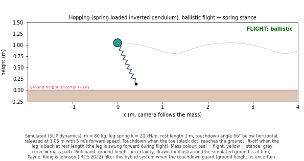
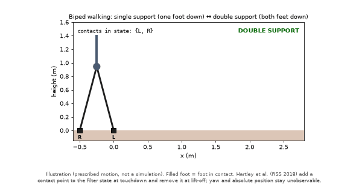
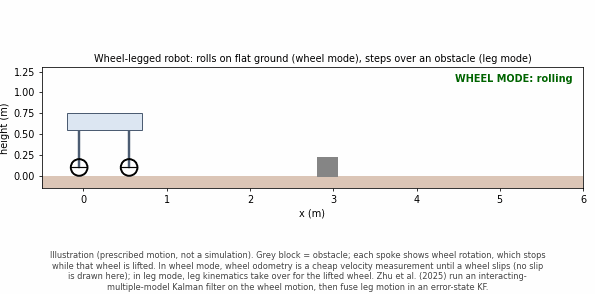
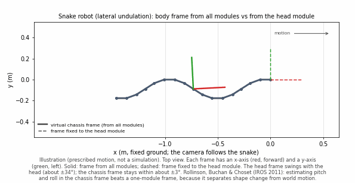
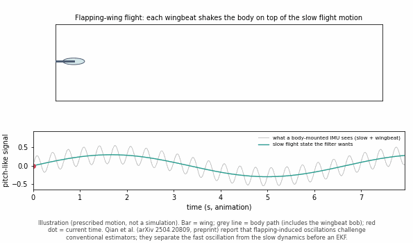
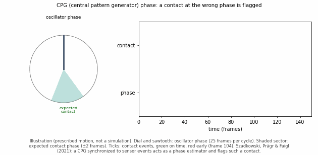
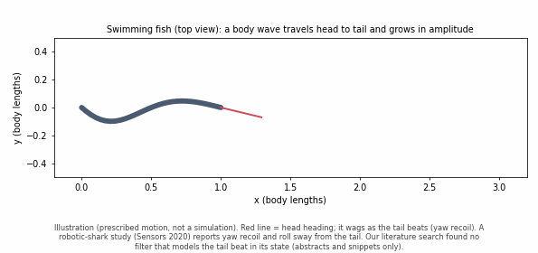
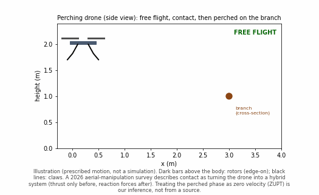
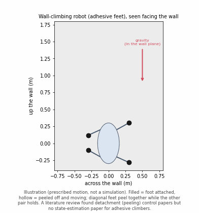

# Literature review: locomotion types not yet in `state-estimation-simulations`

First pass, 2026-10-19. Goal: decide which bio-inspired / hybrid / switched locomotion type could become the next doc, and record what the literature actually says about **state estimation** for each. To be checked and deepened later. Section 3 also covers real robots from the Computational Robotics Lab at the Czech Technical University (CTU) in Prague that map onto docs the repo already has.

## How to read this

- **Animations** (one per type, §2): `figures/<name>.gif`, made by `figures/make_other_locomotion_gifs.py`. Hopping is a real spring-loaded inverted pendulum (SLIP) simulation; all others are labeled illustrations (prescribed motion), not simulations.

- **Evidence level** per source:
  - **read**: abstract or full text read directly.
  - **snippet**: only search-result text seen; verify before citing in a doc.
- **Unverified** = my own inference or framing, not found in a source.
- Search was a single pass per topic (standard web search), not a systematic review. Absence of a source means "not found in this pass", not "does not exist".

## 0. What the repo already covers

Searched `README.md` and `docs/` on 2026-10-19.

| Covered | Mentioned in passing only | Not mentioned |
| --- | --- | --- |
| Bouncing point mass, tumbling rigid body (saltation, invariant saltation), inchworm (zero-velocity update, ZUPT; zero angular-rate update, ZARU, in that doc's §5), friction-anisotropic crawler, hexapod (planar leg odometry; 3D contact-aided invariant extended Kalman filter (InEKF)) | Snake (biological example of anisotropic friction, `friction_anisotropic_ekf.md`), quadruped (one mention and one reference, `hexapod_gait_ekf.md`), compliant ankles (a reference) | Biped, hopping, swimming, flapping flight, perching, wheel-legged, adhesive climbing, central pattern generator (CPG) / gait-phase estimation |

## 1. Summary

| Type | Estimation literature found | Evidence | Fit with the repo |
| --- | --- | --- | --- |
| Hopping (spring-loaded) | Yes: hybrid flight/stance filtering with an uncertain touchdown guard | read | Strong: direct extension of `hybrid_saltation_ekf.md` |
| Biped | Yes: contact-aided InEKF on Cassie | read | Strong: `hexapod_contact_inekf.md` with one or two feet |
| Wheel-legged | Yes: mode-switching filter bank (interacting multiple model Kalman filter (IMM-KF) + error-state Kalman filter (ESKF)) | read (abstract) | Medium: new "which sensor per mode" question |
| Snake | Yes: extended Kalman filter (EKF) in a virtual-chassis frame | read (abstract) | Medium: different core problem (shape vs body motion) |
| Flapping flight | Yes: separating wingbeat oscillation from slow state | read (abstract, preprint) | Medium: periodic disturbance, no contact |
| CPG / gait phase | Partly: CPG as phase estimator (robot); EKF gait phase (prosthesis) | read / snippet | Medium: fills the inchworm doc's "known schedule" gap |
| Swimming (fish) | Thin: tail-beat disturbance described, not modeled in a filter | snippet | Weak |
| Perching | Thin: contact described as a hybrid change; no estimator found | snippet | Weak |
| Adhesive climbing | None found: only detachment control | snippet | Weak |

Real robots for types the repo already covers (inchworm, hexapod): §3.

### 1.1 What the types have in common (fact-checked)

First statement, written during the brainstorm: "The question is always what the robot knows at the moment of the switch. Contact or an anchor gives a free 'this point is not moving' measurement. Flight or smooth shape change gives no such measurement. Switch timing or a periodic disturbance adds uncertainty." Checked 2026-10-19 against the sources in §2 and §3 plus three extra searches. Verdict per claim:

- **"Always about the switch": not supported.** Snake (§2.4), flapping (§2.5) and fish (§2.7) have no contact switch. Their problem is separating a fast periodic or shape-driven motion from the slow body motion. Scope the claim to the types with contact switches.
- **"Contact gives a zero-velocity measurement": supported for legged foot contact, but "free" is wrong.**
  - Hartley et al. (**read**): a planted contact is assumed fixed in the world, with its velocity modeled as zero-mean noise so that slip is allowed. Contact itself comes from a thresholded spring deflection, so a detector is needed.
  - Lee & Kim (2026), *Attention-Based Neural-Augmented Kalman Filter for Legged Robot State Estimation*, IEEE RA-L 11(4), arXiv 2601.18569 (**read**): when the foot slips, "kinematic measurements violate the no-slip assumption and inject bias during the update step".
  - §3.1: the CTU inchworm needs a slip sensor in each pad, and the adaptive gait reached 75% reliability on the high-friction terrain.
  - So the zero-velocity measurement exists only while a detector says the contact holds and the slip model allows for error.
- **Wheel-legged: not shown.** Zhu et al. (**read**, abstract) does not mention contact velocity; the other sources (**snippet**) mention wheel slip and a trust model for contact reliability. My reasoning, not from a source: a rolling wheel's contact point is instantaneously still but the wheel center moves, so this is wheel odometry, not a plain zero-velocity update.
- **"Flight gives no such measurement": supported.** Hopping flight is ballistic with no contact (Payne et al., **read**). Burns & Woodward (**read**, abstract) report that thrust and drag break the ballistic assumption. For perching (§2.8) and climbing (§2.9), "anchored after landing or attaching" is my inference; no estimator was found.
- **"Smooth shape change gives no such measurement": unverified.** The snake sources estimate from shape in the virtual-chassis frame, and none reads as a zero-velocity update. Enner et al. (**snippet**) treat the snake "like a wheeled robot", which hints at a motion constraint. A search for snake state estimation with a nonholonomic (no sideways slip) constraint found nothing. Neither "has" nor "has not" is established.
- **"Switch timing adds uncertainty": supported.** Payne et al. (**read**): uncertain touchdown guard, median mean squared error (MSE) improved 54.7%. Szadkowski et al. (**read**): mistiming flagged from accumulated phase error. HAntR (**read**): contact declared by a fixed threshold on position error.
- **"A periodic disturbance adds uncertainty": supported in a different form.** Flapping (Qian et al., **read, abstract**): oscillations "challenge conventional estimation techniques"; they are separated from the slow state rather than treated as extra noise. Fish (**snippet**): tail recoil causes yaw and roll sway; no filter that models it was found.

**Corrected statement.** For types with contact switches, the estimator has two recurring questions: when contact starts and ends (an imperfect detector), and whether the contact point is actually stationary (slip). A holding contact yields a zero-velocity pseudo-measurement whose reliability depends on both. For types without a contact switch, the problem is separating a fast periodic or shape-driven motion from the slow body motion.

**Checked and dropped.** Two search summaries said more than the papers do. Yang et al., *Multi-IMU Sensor Fusion for Legged Robots* (arXiv 2507.11447): the abstract does not state a zero-velocity assumption. Li et al., *Interacting Multiple Model Proprioceptive Odometry for Legged Robots* (arXiv 2603.29383): the paper is about legged robots, not wheel-legged, and its v2 is marked withdrawn. Neither is used above.

## 2. Per type

### 2.1 Hopping (spring-loaded inverted pendulum, SLIP)

**Intuition:** A pogo stick. The leg is a spring: it compresses on landing, pushes off, and the body flies ballistically.

**What switches:** flight (ballistic) ↔ stance (leg spring compressed). Touchdown when the toe reaches the ground; lift-off when the leg returns to rest length.

**Sources**
- Payne, J. J., Kong, N. J., & Johnson, A. M. (2022). *The Uncertainty Aware Salted Kalman Filter: State Estimation for Hybrid Systems with Uncertain Guards*. IROS 2022 (arXiv 2202.12729). **read (full text)**.
  - Example systems: a 2D bouncing ball on an angled surface, a ball on a circular surface, and an **ASLIP (asymmetric spring-loaded inverted pendulum) hopper**.
  - Hopper state $`q = [x_b, y_b, \theta_b, x_t, y_t, \dot x_b, \dot y_b, \dot\theta_b]`$; "In the aerial phase, the system uses ballistic dynamics with a fixed leg length and angle"; "The guard for touchdown is based on the height of the toe reaching the ground, which is uncertain. The guard for liftoff is based on the leg returning to rest length."
  - Ground height uncertain (std 0.01 m); 1000 trials of 5 s (about 4 hops). The uncertainty-aware filter beat the standard salted Kalman filter (KF) (p < 0.005): median MSE improvement 54.7%, peak per-timestep improvement 60.1%. Gains mostly in the vertical direction.
  - New ingredient vs this repo: a **guard saltation matrix** for an uncertain guard location (the repo's `hybrid_saltation_ekf.md` §8 handles uncertain contact *timing* instead).
  - Hopper model reference: Poulakakis, I. & Grizzle, J. W., *The spring loaded inverted pendulum as the hybrid zero dynamics of an asymmetric hopper*, IEEE TAC (ref. [26] of the paper; not read).
- Yim, J. K., Wang, E. K., & Fearing, R. S. (2019). *Onboard state and velocity estimation for a 0.10 kg monopedal jumping robot, without external sensing*. ICRA 2019. **snippet**. Uses SLIP / Raibert-style control; notes a short, impulse-like stance.
- Burns & Woodward (2024). *Optimized Kalman Filter based State Estimation and Height Control in Hopping Robots*. Kalman-filter-based vertical state estimation for a hopping robot from inertial data only; aerial-phase forces (thrust, drag) break the ballistic assumption. arXiv 2408.11978. **read (abstract)** (840 Hz, 672 g robot, hops up to 4 m, apex-height error 12.5% mean absolute percentage error, MAPE).
- Rossi & Gadsden (2018, CSME; later Springer chapter): comparison of Kalman variants on a simulated planar SLIP model. **snippet**.

**Corrected claims:** an earlier draft said hoppers have "almost no free zero-velocity information". Wrong: a planted toe is stationary during stance. Only the *shortness* of stance is supported (Yim et al.).

**Open questions:** how often is the touchdown guard observable from an inertial measurement unit (IMU) only? Is the stance-phase spring force estimated or known?

### 2.2 Biped walking

**Intuition:** Two-legged walking. At any time one foot, or briefly both, is planted.

**What switches:** which foot is in contact (single support ↔ double support).

**Sources**
- Hartley, R., Ghaffari Jadidi, M., Grizzle, J. W., & Eustice, R. M. (2018). *Contact-Aided Invariant Extended Kalman Filtering for Legged Robot State Estimation*. RSS 2018 (arXiv 1805.10410). **read (abstract + ar5iv full text)**.
  - Tested on a Cassie-series 3D biped. Contact sensing: "The spring deflections are measured by encoders and are thresholded to serve as a binary contact sensor."
  - Contacts are "discrete events that are created and broken". Lift-off: marginalize the contact state "by simply removing the corresponding column and row". Touchdown: initialize the new contact point from forward kinematics, covariance augmented from encoder noise.
  - A planted contact is assumed fixed in the world; its velocity is a zero-mean noise measurement (allows slippage). **No impact / velocity-reset model.**
  - "The absolute position of the robot and a rotation about the gravity vector (yaw) are unobservable."
  - Derivations shown for a single contact point; described as extendable to "an arbitrary (finite) number of points".
  - Code: [UMich-BipedLab/Contact-Aided-Invariant-EKF](https://github.com/UMich-BipedLab/Contact-Aided-Invariant-EKF).
- Note: the repo's `hexapod_contact_inekf.md` already implements this filter family (it cites Hartley et al.), so a biped doc would mostly change the number of contacts.

**Corrected claims:**
- "Yaw drifts faster than in the hexapod": no source; yaw is unobservable for both.
- "The foot impact needs a saltation matrix": not supported for bipeds by what I read; Hartley et al. do not model impacts.

**Open questions:** is there biped estimation work that does model impacts (e.g. Grizzle's hybrid-zero-dynamics line, or salted KF on walking models)? Search "salted Kalman filter biped walking impact".

### 2.3 Wheel-legged (multi-mode) robots

**Intuition:** A vehicle that can drive on wheels or walk on legs, and mix the two.

**What switches:** wheel mode ↔ leg mode (and mixed).

**Sources**
- Zhu, Z., Zhou, Y., Bai, G., Wang, K., Xu, C., & Qin, Y. (2025). *Novel Dual-Kalman-Filter-Based State Estimation Algorithm for Wheel-Legged Multi-mode Autonomous Vehicle*. Automotive Innovation, 8(4), 949-962. doi:10.1007/s42154-024-00336-6. **read (abstract)**.
  - Prior estimation work mostly single-mode. "DUKE": layer 1 an interacting multiple model Kalman filter (IMM-KF) corrects wheel motion; layer 2 an error-state KF fuses leg motion with the estimated wheel motion. Better than single-mode baselines on a real platform.
- CWRKF conference paper: wheel-velocity estimation plus a trust model so motion is computed only from reliable wheel contact (wheel slip in driving/braking). **snippet**; full citation not recorded.
- Four-wheel-legged robot contact-state estimator with a KF, DOI 10.1109/MRAI65197.2025.11135741. **snippet**.

**Open questions:** how is the mode probability (IMM) related to this repo's per-foot χ² gating?

### 2.4 Snake robots

**Intuition:** The robot moves by wiggling its body shape. It has no feet and no contact switch.

**What switches:** no contact mode switch in the cited work; the body shape changes continuously (gaits).

**Sources**
- Rollinson, D., Buchan, A., & Choset, H. (2011). *State Estimation for Snake Robots*. IROS 2011, pp. 1075-1080. **read (abstract summary)**.
  - EKF fusing internal proprioception; shape described by gait parameters. A body frame aligned with the **virtual chassis** gave better pitch and roll than a frame fixed to one module; explicit joint-angle states help in some cases. Ground truth: motion capture, rolling gait.
- Rollinson & Choset, *Virtual Chassis for Snake Robots: Definition and Applications*, Advanced Robotics (2012). **snippet**. Virtual chassis = frame at the averaged link positions, isolating internal shape change from external motion; EKF for pitch/roll from encoders, gyros and accelerometers.
- Enner, Rollinson & Choset (ICRA 2012), *Simplified Motion Modeling for Snake Robots*: world motion from shape changes, treating the snake like a wheeled robot via the virtual chassis. **snippet**.
- Andrews et al. (arXiv 2510.01485, 2025): thruster-driven multi-link robot, unscented Kalman filter (UKF) + Gaussian-process residuals; drifts without absolute position. **snippet**.

**Corrected claim:** "cyclic process noise" was my framing; the literature's core problem is **separating shape change from body motion**.

### 2.5 Flapping-wing flight

**Intuition:** A bird or insect-sized flyer. The wings beat fast and the body moves slowly.

**What switches:** no contact; a fast periodic wingbeat on top of slow flight dynamics.

**Sources**
- Qian, C., Xing, J., Yan, J., Luo, M., Song, S., Lian, X., Fang, Y., Gao, F., & Li, T. (2025). *Periodic Proprioceptive Stimuli Learning and Internal Model Development for Avian-inspired Flapping-wing Flight State Estimation*. arXiv 2504.20809 (preprint). **read (abstract)**. Flapping-induced oscillations "challenge conventional estimation techniques"; low-cost magnetic, angular rate and gravity (MARG) sensors; divide-and-conquer separation of high-frequency oscillation from slow dynamics (cycle-averaged aerodynamics), feeding a learned internal model (the abstract does not name the filter).
- RoboBee hardware-in-the-loop testing of embedded state estimation (arXiv 2411.06382): small payload and "highly non-linear oscillating dynamics" make onboard estimation hard. **snippet**.
- TU Delft MSc thesis: event camera + EKF on a flapping-wing vehicle, good enough for hover. **snippet**.
- IMAV 2018 (KUBeetle): attitude/altitude with low-pass + Kalman filtering. **snippet**.

**My framing to verify:** "power stroke vs recovery stroke" as the switch.

### 2.6 CPG-driven gaits / gait-phase estimation

**Intuition:** Rhythm comes from a clock-like oscillator. Its phase says where the robot is in the gait cycle.

**What switches:** the gait phase becomes an estimated quantity instead of a known schedule (this repo's docs assume a known schedule).

**Sources**
- Szadkowski, R., Prágr, M., & Faigl, J. (2021). *Self-Learning Event Mistiming Detector Based on Central Pattern Generator*. Frontiers in Neurorobotics, 15. doi:10.3389/fnbot.2021.629652. **read (full text, first ~97%)**.
  - Hexapod robot. "If the CPG is synchronized to the sensory signals, the CPG acts as an estimator of the sensory phase." A mistiming is flagged when "the phase error accumulated over one gait cycle exceeds a given threshold"; detections trigger an elevator reflex and a search reflex. The authors say direct use of the CPG as an estimator is uncommon.
- Thatte, N., Shah, T., & Geyer, H. (2019). *Robust and Adaptive Lower Limb Prosthesis Stance Control via Extended Kalman Filter-Based Gait Phase Estimation*. IEEE RA-L, 4(4), 3129-3136. doi:10.1109/LRA.2019.2924841. **snippet**. EKF on joint angle and velocity estimates a continuous phase (0 at heel strike, 1 at toe-off); more robust than threshold-based event detection. **Prosthesis, not a robot.**

**Gap:** no paper found that combines a CPG with a Kalman filter on a legged robot. Next search: "adaptive oscillator phase estimation quadruped Kalman".

### 2.7 Swimming (robotic fish)

**Intuition:** A tail-beating swimmer. The tail makes thrust and also shakes the body side to side.

**What switches:** none; the tail beat is a periodic disturbance, with no contact switch.

**Sources (all snippet)**
- Robotic shark visual stabilization (Sensors, 2020, PMC7412007): tail oscillation "induces a recoil motion in the yaw direction but also a sway in the roll axis".
- 2017 bass-shaped robot: KF on force measurements to estimate self-propelled speed; fish speed varies within each tail-beat cycle.
- 2024 IEEE Access: route estimation for a tail-fin robotic fish from IMU posture and pre-measured speed, particle filter with a magnetic map.
- University of Delaware thesis: quaternion KF vs Lie-group complementary filter for a pectoral-fin robotic fish.

**Gap:** no filter that models the tail beat in its state or process model.

### 2.8 Perching (aerial robots)

**Intuition:** A drone that swoops in and grabs a branch with claws, like a bird.

**What switches:** free flight → contact/grasp.

**Sources (all snippet)**
- Aerial manipulation survey (arXiv 2607.04719, 2026): contact "may transform the aerial robot into a hybrid agent".
- Colorado State dissertation, *Biologically inspired perching for aerial robots*: time-to-contact estimated from consecutive images; passive bistable gripper.
- Penn/CMU dynamic aerial grasping with monocular camera + IMU; TU Delft branch perching; 2025 morphing-arm perching.

**Unverified:** "after landing the body is anchored, a ZUPT-style fact" (my inference).

### 2.9 Adhesive (gecko-style) climbing

**Intuition:** A robot that sticks to a wall with adhesive pads and peels one foot at a time.

**What switches:** each foot attached ↔ detached.

**Sources (all snippet)**
- Detachment/peeling control (Applied Sciences 2021, 11(13):5860).
- Gecko-inspired twisting detachment.
- SFU MENRVA climber that senses impending detachment (no algorithm details).

**Gap:** no state-estimation paper for adhesive climbers found. A related general result (legged robots, not climbing): foot-slip level correlates with InEKF error, Pearson r ≈ 0.68 (Lee & Kim 2026, arXiv 2601.18569, **read**, §II-B).

## 3. Real robots for types the repo already covers: CTU Computational Robotics Lab

Robots from the Computational Robotics Laboratory, Czech Technical University in Prague (<https://comrob.fel.cvut.cz/robots/>). Added 2026-10-19. Unlike §2, these are **existing** types in the repo (inchworm, hexapod), so the question is what each real robot adds to the existing docs.

**Evidence:** the three papers below were **read in full** from the lab's PDFs. Robot pages were read through a summarizer and are thin (most list no gait, sensors or papers). Anything marked **inference** is mine, not the authors'.

### 3.1 Inchworm robot (feeds the inchworm doc and the friction doc)

Robot page: <https://comrob.fel.cvut.cz/robots/inchworm.html> (3D-printed, snake-like, "inchworm-inspired locomotion" with "flexible scales", Dynamixel XM-430; no sensors or papers listed). The two papers below are not linked from the page; I found them by search. A third robot on the index, **MinchW** ("Magnetic Inchworm"), has a page with only a name and a description line; nothing else is documented, so it is not reviewed.

**What switches:** anchor (support) ↔ slide, repeated per gait phase: the same switch as `inchworm_zupt_ekf.md`, but the anchor is held by **friction** (passive anisotropic scales), not by a known-stationary segment.

**Papers**
- Kubík, J., Rišková, A., & Faigl, J. *Inchworm-like Robot Locomotion using Off-the-Shelf 3D-printable Anisotropic Friction Pads*. Venue: The 12th International Symposium on Adaptive Motion of Animals and Machines (AMAM) and 2nd LokoAssist Symposium, 2025, doi:10.26083/tuprints-00030958 (confirmed via ref. [9] of the ICRA paper). **read (full text)**. <https://comrob.fel.cvut.cz/papers/amam25inchworm.pdf>
  - 4 degrees of freedom (DoF); four Dynamixel XM430-W350-R servos on brackets in polyethylene terephthalate glycol (PETG); scales 3D-printed in thermoplastic elastomer (TPE, FiberFlex 40D), 7 mm long, 0.25 mm thick, 1.75 mm spacing, 45° angle. Motivation: replace electromagnet or suction anchoring (iCrawl, pipe robots) with snake-skin friction anisotropy.
  - Three hand-tuned gaits: **sliding** (extend/contract, anisotropy only), **balancing** (adds center-of-mass shifts to load the anchoring pad), **stepping** (moves the segment forward on the pad-end bumpers instead of the scale surface).
  - Terrains (forward/backward static friction): foam (≈1.2 / 1.4), artificial grass (≈0.75 / 1.4), PETG (≈0.2 / 0.2), and 5° and 10° slopes on foam. 10 trials of 30 s each.
  - Results: sliding fails to anchor on smooth PETG and sticks on foam; balancing and stepping approach their expected speed on all terrains. On slopes the front pad slips back slightly at the start of retraction. Cost of transport from servo currents. **No state estimation.**
- Kubík, J. & Faigl, J. *Adaptive Friction-based Inchworm-like Locomotion*. File name suggests ICRA 2026; the text I read does not name the venue (**verify**). **read (full text)**. <https://comrob.fel.cvut.cz/papers/icra26looper.pdf>
  - 6 DoF (can turn); turning via a discrete-step bicycle model, R = L / tan(φ), L = l_min, φ = 2θ_steering.
  - **Slip sensing:** a laser-mouse sensor (PMW3610DM-SUDU, LM18-LSI lens) embedded in each contact pad, read over a serial peripheral interface (SPI) every 10 ms at 1200 counts per inch (CPI). It reports relative XY displacement and a surface-quality metric. The back pad is read during extension, the front pad during contraction.
  - **Slip detection:** a displacement above d_thr = 20 ticks (0.42 mm) is slip; below it is attributed to sensor noise and elastic scale bending (a "heuristic filter").
  - **Adaptation:** on slip, shorten the maximum extension so more weight can be shifted onto the anchoring pad (larger support angle).
  - Results on four terrains (EPE (expanded polyethylene) foam, grass, PETG, smooth table): adaptive ≈ offline-tuned gaits, better on some terrains; 75% reliability on the high-friction terrain, outperformed by the table-tuned gait on PETG (authors hypothesize PETG's sub-millimeter print structure causes tracking errors).
  - Turning-test ground truth: active 3D motion capture (PTI Phoenix VZK10K) at ≈45 Hz, path smoothed with a third-order Savitzky-Golay filter.
  - **Authors' stated future work:** "Future work could explore fusing redundant optical sensors per pad or integrating optical data with motor measurements (position and velocity) and on-board IMU measurements through Kalman filtering to improve reliability."

**Link to the repo** (**inference**, not framed this way by the authors):
- An anchored pad should be stationary, so the pad's displacement sensor is a **velocity-zero measurement**, as in `inchworm_zupt_ekf.md`. Their fixed threshold is a measurement-driven gate (a slip detector on the measured displacement), whereas the doc gates by the known phase; Kalman fusion is the step they list as future work.
- The scales are passive anisotropic friction (forward < backward), the same family as `friction_anisotropic_ekf.md`'s pad (the doc cites snake belly scales). The axes differ: the scales resist backward motion more than forward motion along one axis, while the doc's pad grips along its forward axis and slips sideways, with anisotropic *noise* tied to the body frame.
- Open: how much unmodeled slip enters between sensor reads (10 ms) and whether the threshold behaves like the doc's σ_zupt.

### 3.2 HAntR hexapod (under the hexapod family)

Robot page: <https://comrob.fel.cvut.cz/robots/hantr.html> (in-house six-legged robot, 4 DoF per leg, AX-12A servos; no sensors listed on the page, but the paper below has them). Related platforms on the lab's index (pages only, no estimation content): **PhantomX** (retired Robotis-kit hexapod; cameras incl. Intel RealSense T265; papers on exploration with the T265 and traversability learning), **SCARAB II/III** and the **DARPA Sub-T hexapod** (in-house hexapods, 18 DoF, T265 + D435 cameras; papers on exploration and traversability), **HEBI Daisy** (commercial hexapod, 18 DoF).

**What switches:** which legs are in stance vs swing (statically stable gaits such as tripod); the same switch as `hexapod_gait_ekf.md`.

**Paper**
- Čížek, P., Zoula, M., & Faigl, J. (2021). *Design, Construction, and Rough-Terrain Locomotion Control of Novel Hexapod Walking Robot with Four Degrees of Freedom per Leg*. IEEE Access, 9, 17866-17881. doi:10.1109/ACCESS.2021.3053492. **read (full text)**. <https://comrob.fel.cvut.cz/papers/access21hantr.pdf>
  - Design and control paper (not an estimation paper): over an hour of locomotion with a payload of 85% of its weight; maximum crawled distance per second 87% of its length; weight distributed actively across the stance legs.
  - **Sensors:**
    - Servo **position feedback** (Dynamixel AX-12A): the **only** foot-contact sensing. Contact is declared when the commanded joint position θ_des and the measured θ_real differ by more than a fixed threshold e_thld (method from Faigl & Čížek, *Adaptive locomotion control of hexapod walking robot for traversing rough terrains with position feedback only*, Robotics and Autonomous Systems 116 (2019) 136-147, ref. [23] of the paper; no force or tactile sensors).
    - An **attitude and heading reference system (AHRS)** (Xsens MTi-30, 400 Hz) feeds the locomotion controller; the controller samples a gravity vector for body pose and inclination control.
    - Voltage and current sampled at 500 Hz (power and endurance).
    - Evaluation only: OptiTrack motion capture (6-DoF pose, 30 Hz, slope experiment) and a Leica TS-16 robotic total station (3-DoF position, 10 Hz, rough terrain; speed computed from it).
  - **No onboard camera and no pose filter** in this paper; the T265 appears in the lab's other hexapod papers.

**Link to the repo** (**inference**):
- `hexapod_gait_ekf.md` studies contact-detection timing jitter (`--detect-time-noise-std`); HAntR's position-error threshold is a real detector of that kind. The paper does not report its timing error.
- The lab's T265-based hexapod exploration papers localize with a tracking camera, while the repo's hexapod docs estimate from leg kinematics and an IMU. That contrast is a possible doc section; not read here beyond the PhantomX page's list.
- The same lab wrote the CPG phase-estimator paper in §2.6 (Szadkowski, Prágr & Faigl, 2021); the DARPA Sub-T page lists it. The paper text does not say which robot it used, only "a six-legged hexapod".

### 3.3 Other robots on the index

Not relevant to switched locomotion, or too little documented (pages read through a summarizer):
- Arms and hands: HEBI Lily (1, 2, hand), HEBI Daisy hand, UR5.
- Not described on their pages: Mobot (empty page), Marvin (XL-320 servos, retired, no locomotion details).
- Not opened: Husky, Hunter SE, Hotwing EVO 1200, Bormatec Maja XL (names only on the index).

## 4. Shortlist for a next doc

**Updated 2026-10-23:** this ranking now weighs fit with the CTU lab's robots (§3) first and literature fit (§1) second. The lab's website refused the connection on 2026-10-23 and DBLP blocked access, so nothing newer than §3 (2026-10-19) was checked. The previous ranking (2026-10-19) used literature fit only: hopping, then CPG / gait phase, then biped.

| # | Type | Lab fit (§3) | Repo fit | Verdict |
| --- | --- | --- | --- | --- |
| 1 | **CPG / gait-phase estimation** (hexapod) | Hexapods are the lab's main platform (HAntR, PhantomX, SCARAB, Sub-T, Daisy). The lab's own paper uses a CPG as a phase estimator (§2.6). HAntR's contact detector is a threshold on servo position error (§3.2). | Addresses the "known schedule" assumption every locomotion doc makes; reuses `hexapod_gait_ekf.md` and its `--detect-time-noise-std`. | **Next new doc.** No CPG + Kalman filter paper was found for a legged robot, so the filter design would be ours; label it as such. |
| 2 | **Inchworm, next step** (extension, not a new type) | The lab's most recent line (AMAM 2025, ICRA 2026). Kalman fusion of pad optical sensors, motor and IMU data is the authors' stated future work (§3.1). MinchW (magnetic anchor) is undocumented. | Extends the 1D slip-gate toy (below) to 2D turning (the paper's bicycle model) with one sensor per pad. | Closest to the lab's current work; do it alongside #1 or right after. |
| 3 | Hopping (SLIP) | No lab hopper found. | Strongest literature: uncertain-guard salted KF on an ASLIP hopper; builds directly on `hybrid_saltation_ekf.md`. | Best choice on literature fit alone. |
| 4 | Snake / scale-friction crawling | The inchworm is snake-like with friction scales (§3.1); no snake robot found. | Different core problem: separating shape change from body motion (§2.4). | Low |
| 5 | Biped | No lab biped found. | Reuses `hexapod_contact_inekf.md` with one or two contacts; the impact/saltation angle needs a source first. | Low |
| 6 | Wheel-legged | Wheeled (Husky, Hunter SE) and legged robots on the index, no wheel-legged one found. | New "which sensor per mode" question (§2.3). | Low |
| — | Flapping, fish, perching, climbing | None at the lab; its fixed-wing UAVs are not flapping (**inference** from names only, §3.3). | Thin or no estimation literature. | Dropped |

**Before writing #1:** read Faigl & Čížek (2019) for the detector's timing behavior, and run the adaptive-oscillator search (both in §5).

Not a new doc but an extension of `inchworm_zupt_ekf.md` / `inchworm_zupt_zaru_ekf.py`: add anchor slip, and gate ZUPT by a measured pad displacement instead of the known schedule (CTU robot, §3.1). **Done as a toy:** [`inchworm_slip_gate_ekf.py` and doc §6](https://github.com/huynhthaihoa/state-estimation-simulations/blob/main/docs/filtering/inchworm_zupt_ekf.md#6-side-extension-anchor-slip-and-a-measured-gate). In it the schedule alone is badly overconfident during slip (slip-window NEES about 47), a sensor veto on top of the schedule removes most of that (about 3.5), and a sensor-only gate leaks at the ends of each extend phase. A real pad sensor reads only while its pad is on the ground, which matches the schedule-and-sensor policy, not the sensor-only ones (my reading, not the authors').

## 5. To check later

- [ ] Read the Payne et al. hopper derivation reference ([8] in their paper) and Poulakakis & Grizzle (ASLIP).
- [ ] Find biped work that models impacts in the estimator.
- [ ] Verify the snippet-level numbers (Yim et al.).
- [ ] Get full citations for the CWRKF and four-wheel-legged papers.
- [ ] Search adaptive-oscillator phase estimation for legged robots.
- [ ] Fish / perching / climbing: one targeted search each before discarding.
- [ ] CTU: confirm the ICRA venue of *Adaptive Friction-based Inchworm-like Locomotion* (file name suggests ICRA 2026; the text I read does not name it) and look for a longer version.
- [ ] Read Rišková, Kubík & Faigl, *Automated evaluation of anisotropic friction pads* (AMAM 2025, ref. [21] of the ICRA paper), for the friction doc.
- [ ] CTU: read Faigl & Čížek (Robotics and Autonomous Systems 116 (2019) 136-147, ref. [23] of the HAntR paper) for the position-feedback contact detector's timing behavior.
- [ ] CTU: read the T265-based hexapod exploration paper (Bayer & Faigl, ECMR 2019) for the camera-vs-leg-odometry contrast.
- [x] CTU: sketch a short inchworm-doc section framing the pad displacement sensor as a measurement-gated ZUPT (done as doc §6, 2026-10-19; a 1D toy with a body-mounted sensor, not the CTU robot's pad sensor).

## Sources

- Lee & Kim, neural-augmented Kalman filter (slip violates the no-slip assumption; foot slip vs InEKF error): <https://arxiv.org/abs/2601.18569>
- Hartley et al., Contact-Aided InEKF: <https://arxiv.org/abs/1805.10410> · <https://ar5iv.arxiv.org/html/1805.10410>
- Payne, Kong, Johnson, uaSKF: <https://arxiv.org/abs/2202.12729>
- Yim, Wang, Fearing, ICRA 2019: <https://ptolemy.berkeley.edu/projects/robotics/%7Eronf/PAPERS/jyim-icra2019.pdf>
- Burns & Woodward: <https://arxiv.org/abs/2408.11978v3>
- Rossi & Gadsden: <https://macsphere.mcmaster.ca/handle/11375/31148>
- Zhu et al., DUKE: <https://pure.bit.edu.cn/en/publications/novel-dual-kalman-filter-based-state-estimation-algorithm-for-whe/>
- Four-wheel-legged fusion: <https://scholar.hit.edu.cn/en/publications/a-multi-modal-fusion-framework-for-state-estimation-in-four-wheel/>
- Rollinson, Buchan, Choset: <https://publications.ri.cmu.edu/state-estimation-for-snake-robots>
- Virtual chassis: <https://www.ri.cmu.edu/publications/virtual-chassis-for-snake-robots-definition-and-applications>
- Simplified motion modeling: <https://www.ri.cmu.edu/publications/simplified-motion-modeling-for-snake-robots>
- Andrews et al.: <https://arxiv.org/html/2510.01485v2>
- Qian et al.: <https://arxiv.org/abs/2504.20809>
- RoboBee HIL: <https://arxiv.org/abs/2411.06382v1>
- TU Delft flapping-wing thesis: <https://repository.tudelft.nl/file/File_7fa06dde-c434-45b4-9a4d-92cf5c69ac35?preview=1>
- KUBeetle, IMAV 2018: <https://www.imavs.org/papers/2018/28.pdf>
- Szadkowski, Prágr, Faigl: <https://www.frontiersin.org/journals/neurorobotics/articles/10.3389/fnbot.2021.629652/full>
- Thatte, Shah, Geyer: <https://doi.org/10.1109/LRA.2019.2924841>
- Robotic shark, Sensors 2020: <https://www.ncbi.nlm.nih.gov/pmc/articles/PMC7412007/>
- Robotic fish route estimation (IEEE Access 2024): <https://tus.elsevierpure.com/en/publications/route-estimation-toward-autonomous-swimming-of-robotic-fish/>
- Pectoral-fin robotic fish thesis: <https://udspace.udel.edu/items/0a0e6457-220f-4abf-8fe8-d446d9c16a9e>
- Aerial manipulation survey: <https://arxiv.org/pdf/2607.04719>
- Biologically inspired perching: <https://mountainscholar.org/items/b716c1aa-2fd1-44fa-a9a0-92c394c4cb9d>
- Climbing detachment control: <https://www.mdpi.com/2076-3417/11/13/5860/xml>
- SFU MENRVA climbing robots: <https://www.sfu.ca/menrva/some-projects/past-research-projects/climbing-robots.html>
- CTU Computational Robotics Lab robots: <https://comrob.fel.cvut.cz/robots/>
  - Inchworm: <https://comrob.fel.cvut.cz/robots/inchworm.html>
  - MinchW: <https://comrob.fel.cvut.cz/robots/michnworm.html>
  - HAntR: <https://comrob.fel.cvut.cz/robots/hantr.html>
  - PhantomX: <https://comrob.fel.cvut.cz/robots/phantom.html>
  - SCARAB: <https://comrob.fel.cvut.cz/robots/scarab2.html>
  - DARPA Sub-T: <https://comrob.fel.cvut.cz/robots/darpa.html>
  - Daisy: <https://comrob.fel.cvut.cz/robots/daisy.html>
- Yang et al., *Multi-IMU Sensor Fusion for Legged Robots* (checked and dropped, see §1.1): <https://arxiv.org/abs/2507.11447>
- Li et al., *Interacting Multiple Model Proprioceptive Odometry for Legged Robots* (checked and dropped, see §1.1): <https://arxiv.org/abs/2603.29383>
- Kubík, Rišková, Faigl (inchworm, friction pads): <https://comrob.fel.cvut.cz/papers/amam25inchworm.pdf>
- Kubík, Faigl (adaptive inchworm): <https://comrob.fel.cvut.cz/papers/icra26looper.pdf>
- Čížek, Zoula, Faigl (HAntR): <https://comrob.fel.cvut.cz/papers/access21hantr.pdf> · <https://doi.org/10.1109/ACCESS.2021.3053492>
