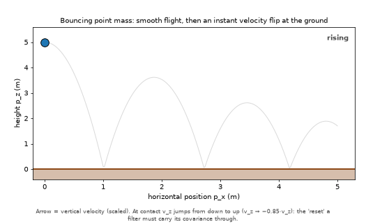
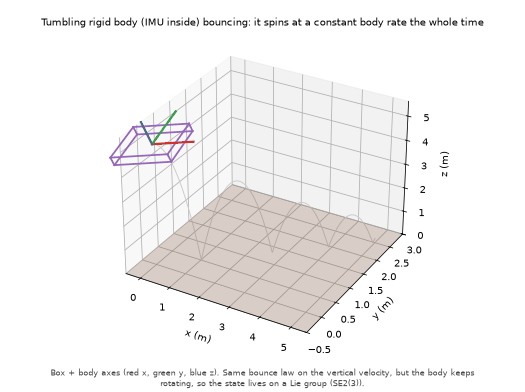
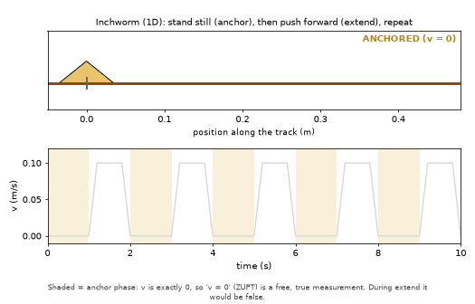
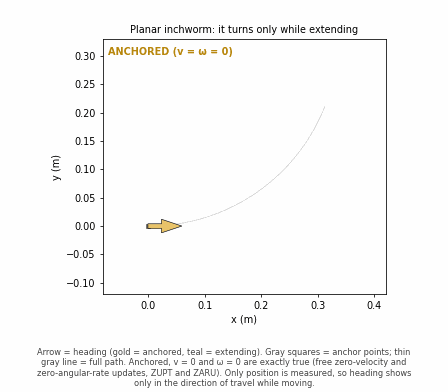
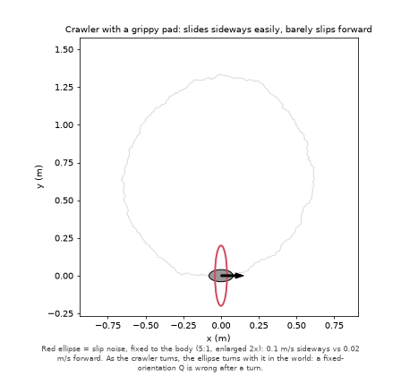
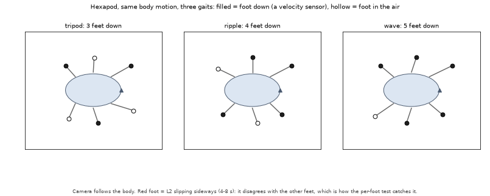
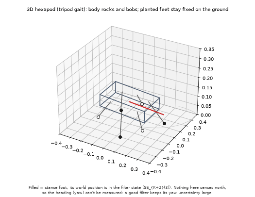

# Study guide: hybrid/switched locomotion docs

Personal notes for reading the `state-estimation-simulations` locomotion docs. Update as understanding improves.

Docs: 
- [hybrid_saltation_ekf](../state-estimation-simulations/docs/filtering/hybrid_saltation_ekf.md) 
- [invariant_saltation_ekf](../state-estimation-simulations/docs/filtering/invariant_saltation_ekf.md)
- [inchworm_zupt_ekf](../state-estimation-simulations/docs/filtering/inchworm_zupt_ekf.md)
- [friction_anisotropic_ekf](../state-estimation-simulations/docs/filtering/friction_anisotropic_ekf.md) 
- [hexapod_gait_ekf](../state-estimation-simulations/docs/filtering/hexapod_gait_ekf.md)-
- [hexapod_contact_inekf](../state-estimation-simulations/docs/filtering/hexapod_contact_inekf.md)

## 1. One frame for all of them

A legged or crawling robot switches mode: anchored/moving, foot down/up, before/after a bounce. Each doc asks what the filter should do at that switch. Ask of every doc: **what switches?**

| What switches | What changes | Doc |
| --- | --- | --- |
| **The state itself** | Velocity jumps (bounce); the covariance must be carried through the jump | hybrid_saltation, invariant_saltation |
| **What you may assume** | "v = 0" (or "ω = 0") is true in one phase, false in another | inchworm (ZUPT; ZARU in §5) |
| **Which sensors you have** | Planted feet = velocity measurements; the gait sets how many | hexapod_gait, hexapod_contact |
| (no switch) | Motion noise depends on direction | friction_anisotropic |

Most confusion comes from mixing up which of the three rows applies.

## 2. One mental picture per doc

- **Saltation (bounce):** drop two balls a hair apart. Near the bounce one is still falling while the other already bounced, so their velocities have opposite signs. That gap is what the saltation matrix adds on top of the plain reset Jacobian.

  
  

- **Inchworm ZUPT:** "I'm standing still" is a free, very precise measurement, but only when it's true. Said while moving, it's a confident lie the filter believes.

  

- **Inchworm ZARU (§5):** with position-only sensing, you learn the heading only by watching which way the body moves. While it stands still, the heading uncertainty can only grow, unless you also assert "I'm not turning".

  

- **Friction:** the robot's pad grips along its forward axis and slips sideways, so the noise ellipse is fixed to the body and rotates with the heading in the world.

  

- **Hexapod gait:** each planted foot is a speedometer. The gait sets how many speedometers you have at each moment; a slipping foot disagrees with the others.

  

- **Hexapod contact InEKF:** nothing the robot senses tells it where north is, so yaw is unobservable. A good filter keeps reporting large yaw uncertainty instead of becoming confident.

  


*Motion-only GIFs (true motion, no filters) from each simulation's own truth generator at its defaults, seed 0. Regenerate: `uv run --project state-estimation-simulations python tasks/figures/make_locomotion_gifs.py [name]` from the repo root.*

## 3. Predict first, then run

Write down the expected outcome before running. Run from `state-estimation-simulations/`. Flags checked on 2026-10-19.

```bash
# Saltation: contact detected late or noisily? (doc §8)
uv run python use_numpy/saltation_matrix_ekf.py --detect-time-noise-std 0.01

# Inchworm: is NEES close to 2 when the process noise covers the ramps? (doc §3)
uv run python use_numpy/inchworm_zupt_ekf.py --process-noise-std 0.5
# ...and with no motion at all?
uv run python use_numpy/inchworm_zupt_ekf.py --v-extend 0

# Inchworm §5: does ZARU still matter if the body never turns?
uv run python use_numpy/inchworm_zupt_zaru_ekf.py --omega-extend 0 --process-noise-std 0.5 --process-noise-ang-std 1.5

# Friction: make the pad isotropic (equal grip/slip noise). Does the heading-aware filter still win?
uv run python use_numpy/friction_anisotropic_ekf.py --sigma-slip 0.02

# Hexapod gait: faster slip on another leg. Does the per-foot test still catch it?
uv run python use_numpy/hexapod_gait_ekf.py --slip-leg R1 --slip-speed 0.3
```

When the result surprises you, that's usually the doc's point. Example: at its defaults, the inchworm filter that applies ZUPT correctly is less well calibrated than the one that never applies it.

| Experiment | My prediction | Result | Takeaway |
| --- | --- | --- | --- |
| | | | |

## 4. Reading habits

1. **Watch the GIF before the math.** Each doc embeds one from `assets/`. For each method, find the moment it goes wrong.
2. **Read NEES as honesty.** Above the expected value = overconfident; below = cautious. Every doc here judges success this way.
3. **For any surprising number, find the doc's control run** (no motion, noise covering the ramps, ...), which isolates the cause.
4. **Keep three lists while reading: switch → assumption → consequence.** That is the content of this set of docs.

## 5. Open questions / notes

- 
